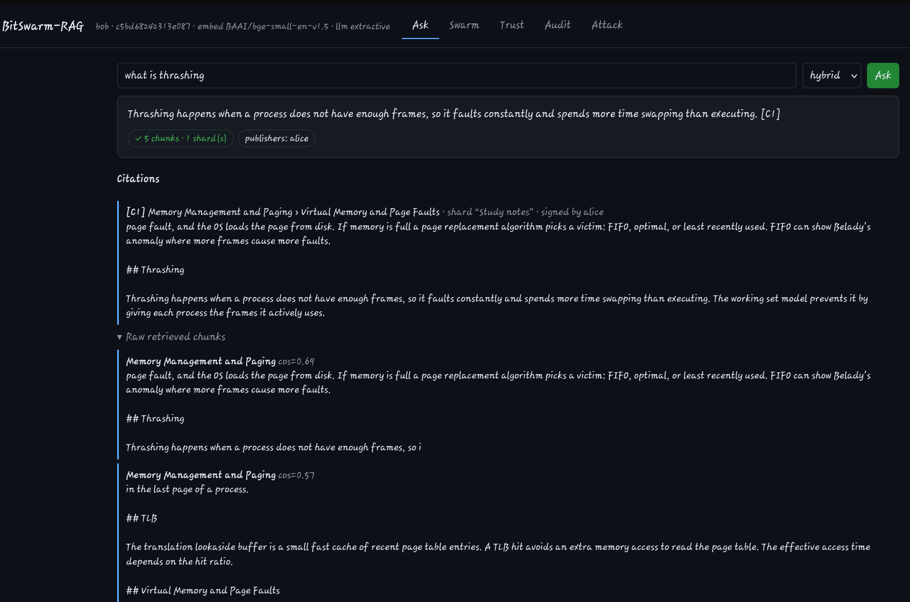
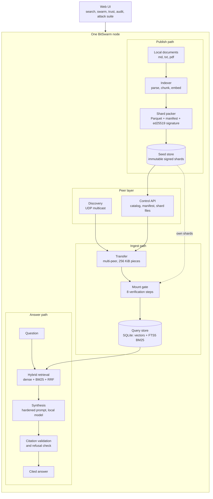
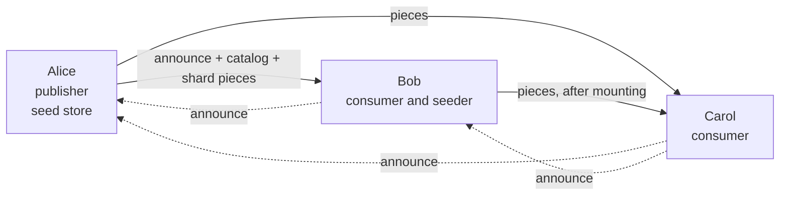
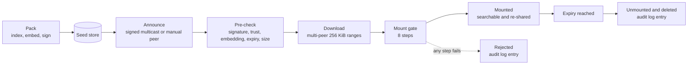
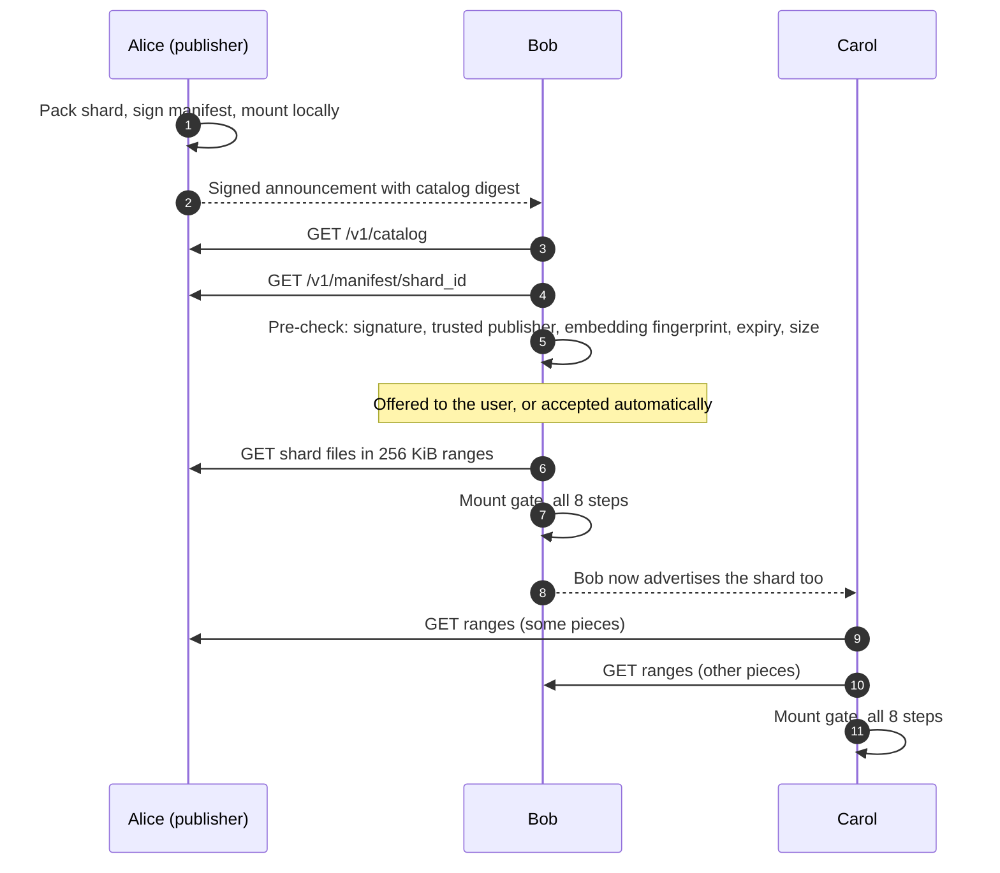
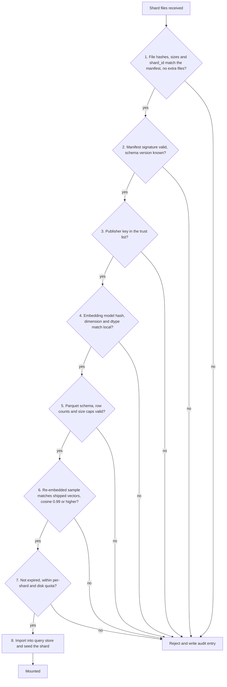
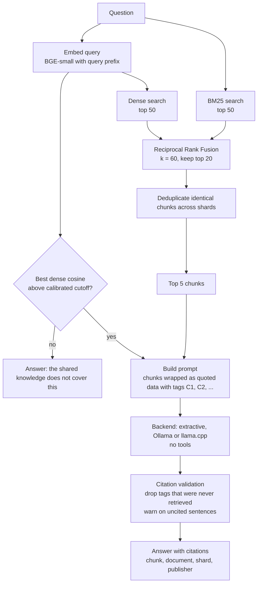
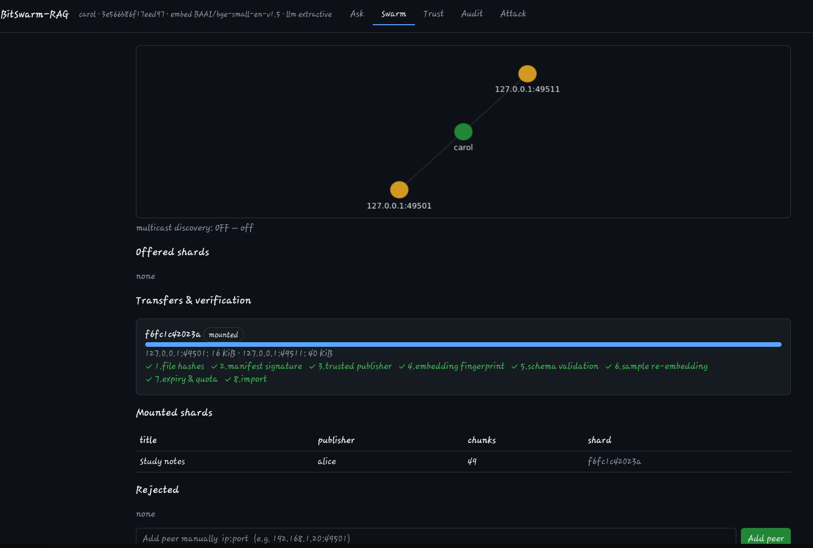
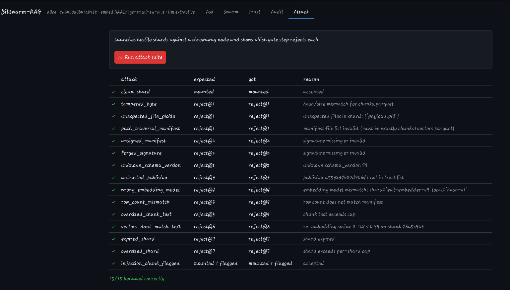
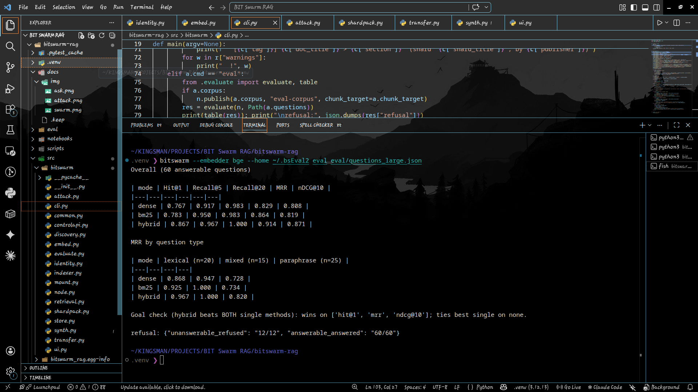

<div align="center">

# BitSwarm-RAG

**Serverless, signed, content-addressed knowledge sharing for small offline teams.**

Index locally. Share signed *knowledge shards* over the LAN. Ask cited questions over the whole team's knowledge, fully offline.




</div>

---

Each team member indexes their own documents on their own machine, packs the result into a signed and immutable *knowledge shard*, and shares it with teammates over the local network. Every node then runs private, offline, cited retrieval-augmented generation (RAG) over the whole team's knowledge. There is no cloud service, no central server, and no account system.

## Highlights

| | |
|---|---|
| **Serverless** | No node is special. Any node can leave and the rest keep working. |
| **Verified authorship** | Every shard carries an ed25519 signature. Only explicitly trusted publishers are mounted. |
| **Eight-step mount gate** | Hashes, signature, trust, embedding compatibility, schema, vector sample re-embedding, expiry and quotas are all checked before import. |
| **Swarm transfer** | Shards download from several seeders in parallel in 256 KiB pieces. |
| **Hybrid retrieval** | Dense (BGE-small) plus BM25, fused with Reciprocal Rank Fusion. Hybrid scored Hit@1 0.867 against 0.767 for dense and 0.783 for BM25 on the project's 60-question set. |
| **Cited answers and refusal** | Citations are validated against retrieved chunks. Off-topic questions are refused. |
| **Ephemeral sharing** | Shards can carry an expiry and are unmounted and deleted automatically. |
| **Tested by attack** | An adversarial suite builds hostile shards and checks each is rejected at the correct step. |

## Table of contents

- [BitSwarm-RAG](#bitswarm-rag)
  - [Highlights](#highlights)
  - [Table of contents](#table-of-contents)
  - [1. The problem and why this project exists](#1-the-problem-and-why-this-project-exists)
  - [2. Design Goals and Rationale](#2-design-goals-and-rationale)
  - [3. What it does and what it does not do](#3-what-it-does-and-what-it-does-not-do)
  - [4. Key design decisions](#4-key-design-decisions)
  - [5. Architecture](#5-architecture)
    - [5.1 One node](#51-one-node)
    - [5.2 A team of three nodes](#52-a-team-of-three-nodes)
    - [5.3 Shard lifecycle](#53-shard-lifecycle)
    - [5.4 Components](#54-components)
  - [6. Data formats](#6-data-formats)
    - [6.1 On-disk layout of a node](#61-on-disk-layout-of-a-node)
    - [6.2 A shard](#62-a-shard)
    - [6.3 Manifest fields](#63-manifest-fields)
  - [7. Network design and sync protocol](#7-network-design-and-sync-protocol)
    - [7.1 Discovery](#71-discovery)
    - [7.2 Control API](#72-control-api)
    - [7.3 Ports](#73-ports)
    - [7.4 End-to-end sync](#74-end-to-end-sync)
  - [8. Security model and the mount gate](#8-security-model-and-the-mount-gate)
    - [8.1 Threat model](#81-threat-model)
  - [9. Retrieval and answer pipeline](#9-retrieval-and-answer-pipeline)
  - [10. Demo](#10-demo)
  - [11. Evaluation](#11-evaluation)
    - [11.1 Setup](#111-setup)
    - [11.2 Retrieval results](#112-retrieval-results)
    - [11.3 Refusal](#113-refusal)
    - [11.4 How to read these numbers](#114-how-to-read-these-numbers)
    - [11.5 Reproduce](#115-reproduce)
  - [12. Testing](#12-testing)
  - [13. Installation and quickstart](#13-installation-and-quickstart)
    - [Three nodes on one machine](#three-nodes-on-one-machine)
    - [On a real LAN](#on-a-real-lan)
    - [A real language model](#a-real-language-model)
  - [14. Command reference](#14-command-reference)
  - [15. Repository layout](#15-repository-layout)
  - [16. Project status](#16-project-status)
  - [17. Known limitations](#17-known-limitations)
  - [18. Roadmap](#18-roadmap)
  - [19. Lessons learned](#19-lessons-learned)
  - [20. Technology stack](#20-technology-stack)
  - [21. Contributing](#21-contributing)
  - [22. License](#22-license)

---

## 1. The problem and why this project exists

Small teams such as study groups, research labs, hackathon teams and field crews accumulate shared knowledge: lecture notes, design documents, runbooks, papers, meeting notes. The usual ways of sharing it each fail in some setting:

| Approach | Where it breaks |
|---|---|
| Cloud workspace plus an AI assistant | Needs internet, accounts and a trust decision about a third party. Not usable offline or with private material. |
| Shared network folder | Needs one machine to act as the server. There is no record of who published what, and nothing verifies that a file was not altered. |
| Hosted vector database | A central service to run and secure. A single point of failure, and it needs connectivity. |
| Sending files by chat | No search, no provenance, and no way to ask questions across everything at once. |

The need is narrow but real: **shared, searchable, question-answering knowledge for a small group that may have no internet, no server, and no reason to trust every machine on the network.**

BitSwarm-RAG is a design for that case. It does not try to beat a shared folder on speed for five people. Its value is in four properties a shared folder does not give you:

- **Serverless operation.** No node is special. Any node can leave and the rest keep working.
- **Verified authorship.** Every shard carries an ed25519 signature, and a node only mounts shards from publishers it has explicitly trusted.
- **Verified integrity and compatibility.** A shard is checked end to end before any of its content can influence an answer.
- **Ephemeral sharing.** Shards can carry an expiry date and are unmounted and deleted automatically.

---

## 2. Design Goals and Rationale

Most retrieval-augmented generation (RAG) systems assume a single hosted index, a cloud-hosted model and one trusted operator. That assumption breaks down in the environments where small teams most need shared knowledge: networks that isolate clients, labs without an uplink, and field or event settings with unreliable connectivity.

BitSwarm-RAG treats RAG as a distributed-systems and security problem as well as a modelling problem. The design is organised around three questions.

**1. What should be replicated between machines: the index or the data?**
An early design sharded an HNSW graph into torrent pieces. Analysis showed that a byte range of a graph index is not independently usable, and that serialised index files are fragile across library versions. The final design replicates plain data (text, vectors and metadata) and rebuilds the search index locally on every node. This made verification, deduplication and compatibility checks tractable, and it means the query store can be deleted and rebuilt at any time.

**2. How can a node trust content it did not create?**
A hash proves integrity, not authorship. Because peer-supplied text is passed to a language model, shared content is both a prompt-injection and a data-poisoning surface. The system therefore combines:
- ed25519-signed manifests and an explicit trust list for authorship,
- an eight-step mount gate that validates every shard before import,
- hardened prompting, where chunks are treated as quoted data, the synthesis step has no tools, and citations are validated,
- an adversarial test suite that checks each hostile shard is rejected at the correct step.

**3. How can the retrieval design be validated?**
Design claims are backed by measurement. The repository includes an evaluation harness, a typed 60-question benchmark with deliberate hard-negative documents, and a calibration command for the refusal threshold.

The system is designed to be both measured and attacked. The sections that follow report what held up and what did not.

The project is built to be measured and attacked, not only demonstrated. The sections below report what held up and what did not.

---

## 3. What it does and what it does not do

**It does**

- Index Markdown, text and PDF files; chunk them; embed them locally.
- Pack the result into an immutable, signed shard (Parquet data plus a signed manifest).
- Discover teammates on the LAN with signed UDP multicast announcements, with manual peers as a fallback.
- Transfer shards from several seeders at once, then verify them through an eight-step gate before import.
- Answer questions with hybrid retrieval (dense plus BM25 fused by Reciprocal Rank Fusion), a hardened prompt, citation validation and an explicit refusal path.
- Show the swarm, per-step verification, trust list and audit log in a local web interface.
- Expire and unmount shards automatically.

**It does not**

- Distribute a vector database or route queries between machines. Queries are always local.
- Claim to be faster than a shared folder for a small team.
- Authenticate or encrypt the control API yet (see [limitations](#17-known-limitations)).
- Recall data a peer has already copied. You can stop future sharing and delete your own copy, nothing more.

---

## 4. Key design decisions

| # | Decision | Reason |
|---|---|---|
| 1 | Shards contain data only (Parquet). Each node rebuilds its search index locally. | An HNSW graph is one connected structure, so a byte range of it is useless, and index files break across library versions. |
| 2 | Two stores per node: an immutable **seed store** and a disposable **query store**. | The seed store is what gets shared and never changes. The query store can be deleted and rebuilt at any time. |
| 3 | Replication is the core. Queries never leave the machine. | Federated query is a different architecture with its own failure modes and is out of scope. |
| 4 | All mounted shards go into one local index with global BM25 statistics. | IDF differs per shard, so per-shard BM25 scores cannot be merged. |
| 5 | The manifest pins embedding model name, file hash, dimension and dtype. A mismatch is rejected. | Vectors from different models are not comparable. |
| 6 | ed25519 identity, signed canonical manifests and an explicit trust list. | Hashes prove integrity, not authorship. |
| 7 | Peer content is treated as untrusted input to the language model. | Signed-publisher gate, sample re-embedding, delimited quoted data, no tools in the synthesis step, citation validation. |
| 8 | Custom discovery over UDP multicast, with a mandatory manual-peer fallback. | Private teams should not use public DHT or trackers, and many Wi-Fi networks block multicast. |
| 9 | Retrieval scores are never thresholded across modes. Refusal uses the dense cosine only and is calibrated per embedder. | RRF scores are rank-based and cannot be thresholded. |
| 10 | Shards carry an optional expiry and are unmounted automatically. | Ephemeral sharing needs a mechanism, not only a word. |

---

## 5. Architecture

### 5.1 One node

Every node has the same components. A node can publish, consume, or both.



### 5.2 A team of three nodes



Once Bob has verified and mounted the shard he advertises it, so Carol downloads pieces from Alice and Bob in parallel. This is the swarm effect, and it was observed live (see the [demo](#10-demo)).

### 5.3 Shard lifecycle



### 5.4 Components

| Component | Module | Responsibility |
|---|---|---|
| Identity | `identity.py` | Generate and load the ed25519 key (file mode 0600), sign and verify, manage the trust list. |
| Indexer | `indexer.py` | Parse documents, chunk on paragraph boundaries with overlap, embed with the title and heading prepended. |
| Embedders | `embed.py` | `bge` (BGE-small-en-v1.5 through fastembed) for real use, `hash` (deterministic) for offline tests. |
| Shard packer | `shardpack.py` | Write Parquet files, compute hashes and the content-derived shard ID, build and sign the manifest. |
| Mount gate | `mount.py` | The eight-step verification pipeline and the audit log. |
| Query store | `store.py` | One SQLite database: vectors plus an FTS5 full-text index over all mounted shards. |
| Retrieval | `retrieval.py` | Dense search, BM25, RRF fusion, deduplication. |
| Synthesis | `synth.py` | Prompt construction, backends (extractive, Ollama, llama.cpp), citation validation, refusal. |
| Discovery | `discovery.py` | Signed multicast announcements, peer table, expiry of silent peers. |
| Control API | `controlapi.py` | Catalog, manifest, torrent and shard-file endpoints with range requests and rate limiting. |
| Transfer | `transfer.py` | HTTP multi-peer swarm (default) and a libtorrent wrapper. |
| Node | `node.py` | Wires everything together and runs the sync loop. |
| Evaluation | `evaluate.py` | Retrieval metrics, per-type breakdown, refusal check, threshold calibration. |
| Attack suite | `attack.py` | Builds hostile shards and checks each is rejected at the correct step. |
| Interface | `ui.py`, `cli.py` | Local web interface and command line. |

---

## 6. Data formats

### 6.1 On-disk layout of a node

```
<home>/
  config.json            team secret, ports, embedder, refusal cutoff
  identity/              node.key (mode 0600), node.pub, name.txt
  trust/                 one <name>.pub file per trusted publisher key
  seed/<shard_id>/       immutable shard directories (what this node shares)
  incoming/              downloads in progress, deleted after the gate
  torrents/              .torrent files
  query_store/           local SQLite database (rebuildable, safe to delete)
  logs/audit.jsonl       every mount, rejection and expiry
```

### 6.2 A shard

A shard is one directory containing exactly four files. The gate rejects any other file.

| File | Content |
|---|---|
| `chunks.parquet` | One row per chunk: `chunk_id`, `doc_id`, `doc_title`, `source_ref`, `chunk_index`, character offsets, `section`, `text` |
| `vectors.parquet` | `chunk_id` and the vector as little-endian float16 bytes, L2-normalised |
| `manifest.json` | Canonical JSON description of the shard (below) |
| `manifest.sig` | Detached ed25519 signature over the canonical manifest bytes |

Rules: no pickles, no serialised indexes, no executables, data formats only. Shards are immutable. An update is a new shard that names the shard it supersedes. The shard ID is the SHA-256 of the sorted per-file hashes, so it is self-certifying.

### 6.3 Manifest fields

| Field | Meaning |
|---|---|
| `schema_version` | Manifest format version. Unknown versions are rejected. |
| `shard_id` | Hash over the sorted file hashes. |
| `supersedes` | Optional shard ID this one replaces. |
| `title`, `description`, `tags`, `language` | Human-facing metadata. |
| `publisher` | Public key and display name. |
| `created_at`, `expires_at` | Timestamps. Expiry is optional. |
| `embedding` | Model name, model file SHA-256, dimension, dtype, normalisation flag, query prefix. |
| `chunking` | Strategy, target size, overlap, tokenizer. |
| `bm25_tokenizer` | Tokenizer profile so every node tokenizes identically. |
| `counts` | Documents and chunks. |
| `files` | List of path, size and SHA-256. |
| `privacy` | Whether source paths were redacted. |

Signatures cover a canonical serialisation (sorted keys, fixed separators), so they are reproducible across machines.

---

## 7. Network design and sync protocol

### 7.1 Discovery

| Property | Value |
|---|---|
| Transport | UDP multicast, group `239.255.49.50`, port 49500, TTL 1 (link-local only) |
| Interval | Every 5 seconds with random jitter |
| Message | Protocol version, team hash, node ID, public key, ports, catalog digest, timestamp |
| Authentication | ed25519 signature by the node **and** an HMAC keyed with the shared team secret |
| Replay defence | Messages outside a 30 second window are dropped |
| Peer expiry | A peer is dropped after about three missed intervals |
| Fallback | Manual peers (`--peer ip:port` or the "Add peer" box). Shared and campus Wi-Fi often blocks multicast, so nothing depends on it. |

### 7.2 Control API

| Endpoint | Purpose |
|---|---|
| `GET /v1/health` | Version, node ID, embedding fingerprint |
| `GET /v1/catalog` | Shards this node holds |
| `GET /v1/manifest/{shard_id}` | Signed manifest |
| `GET /v1/torrent/{shard_id}` | Torrent metainfo, when present |
| `GET /v1/shard/{shard_id}/{file}` | One shard file, with HTTP range support |

The API binds to `127.0.0.1` by default, applies a per-IP token-bucket rate limit, and serves only whitelisted file names for validated 64-hex shard IDs.

### 7.3 Ports

| Purpose | Default | Protocol |
|---|---|---|
| Discovery | 49500 | UDP multicast |
| Control API | 49501 | TCP |
| libtorrent (spike and torrent creation) | 49502 | TCP and UDP |
| Web UI | 8080 | TCP, localhost only |

### 7.4 End-to-end sync



Pieces are assigned round-robin across every peer that advertises the shard. A failed peer is skipped and its pieces are retried on the others.

---

## 8. Security model and the mount gate

Every shard that arrives from a peer passes the same eight steps in order. Any failure rejects the shard and writes an entry to the audit log. Nothing is imported until every step has passed.



### 8.1 Threat model

| Threat | Mitigation | Status |
|---|---|---|
| Tampering in transit | Per-file SHA-256 in a signed manifest | tested |
| Forged authorship | ed25519 signed manifests and an explicit trust list | tested |
| Rogue machine joins the LAN | Team HMAC on announcements, trust list gates acceptance, optional manual approval | tested |
| Poisoned embeddings used to hijack retrieval | Trusted publishers only, plus re-embedding of a random sample | tested |
| Prompt injection inside chunks | Chunks passed as delimited quoted data, rules forbid following instructions inside them, the synthesis step has no tools, control tokens stripped, instruction-like chunks flagged in the UI | tested on the flagging path |
| Malicious file parsing | Data-only formats, no pickles, exact file whitelist, size caps | tested |
| Path traversal through the manifest | Exact file-name whitelist | tested |
| Replay of old announcements | 30 second timestamp window | tested |
| Disk filling and denial of service | Per-shard and total quotas, rate limiting, response caps | partly tested |
| Eavesdropping on the LAN | Not mitigated yet. Shard encryption and TLS are planned. | open |
| Unauthenticated catalog access | Not mitigated yet. Bind to localhost unless the LAN is trusted. | open |

Revocation is manual: remove the publisher's key file from every node's trust directory.

---

## 9. Retrieval and answer pipeline



Details that matter:

- **RRF** scores each result as the sum of `1 / (60 + rank)` over the ranked lists. It uses ranks only, so dense and BM25 results merge without score normalisation.
- **BM25 statistics are global.** All mounted shards live in one local FTS5 index.
- **Chunking** targets about 400 words (80 for the evaluation), splits on paragraph boundaries, keeps an overlap, and prepends the document title and section heading before embedding.
- **Refusal** uses the best dense cosine against a threshold stored in the node configuration. The default for BGE-small is a conservative starting value, and `bitswarm calibrate --save` derives a value from your own questions. See the [limitations](#17-known-limitations) for why this is a weak signal.
- **The extractive backend** returns the best matching sentences from the retrieved chunks with their citation tags. It cannot hallucinate, which makes it a safe default, and it can be replaced by a local language model.

---

## 10. Demo

Three nodes on one machine, separate home directories and ports, no internet required after the embedding model is cached. Alice publishes a signed shard. Bob and Carol discover her, verify the shard through all eight steps, and answer questions from their own local copy.

**Carol downloads from two seeders at once and passes all eight gate steps.** In this run Alice supplied 16 KiB and Bob supplied 40 KiB of the 49-chunk "Study notes" shard.



**Attack suite.** Thirteen hostile shards are rejected at the expected gate step. One shard carrying an injection payload is accepted but flagged and treated as data. One clean shard is accepted as a control.



**Retrieval evaluation on 60 questions with real BGE embeddings.**



---

## 11. Evaluation

### 11.1 Setup

| Item | Value |
|---|---|
| Hardware | Intel Core i5-1135G7, CPU only |
| Embedding model | BGE-small-en-v1.5 (384 dimensions) |
| Corpus | 21 documents on operating systems, networking, databases, cryptography, Java, Spring, Python, machine learning, REST, Docker and Git. Several documents are deliberate hard negatives (the word "hash" appears in hash tables, cryptographic hashes and Git, "deadlock" in operating systems, Java and SQL). |
| Questions | 60 answerable, in three types: 20 lexical (exact terms), 25 paraphrase (little or no shared vocabulary), 15 mixed. Plus 12 unanswerable. |
| Chunking | 80 words per chunk |
| Metric level | Document level: a result counts as relevant if it comes from an expected document |

### 11.2 Retrieval results

| mode | Hit@1 | Recall@5 | Recall@20 | MRR | nDCG@10 |
|---|---|---|---|---|---|
| dense (BGE) | 0.767 | 0.917 | 0.983 | 0.829 | 0.808 |
| BM25 | 0.783 | 0.950 | 0.983 | 0.864 | 0.819 |
| **hybrid (RRF, k = 60)** | **0.867** | **0.967** | **1.000** | **0.914** | **0.871** |

MRR by question type:

| mode | lexical (n=20) | mixed (n=15) | paraphrase (n=25) |
|---|---|---|---|
| dense | 0.868 | 0.947 | 0.728 |
| BM25 | 0.925 | 1.000 | 0.734 |
| hybrid | 0.967 | 1.000 | 0.820 |

Hybrid is ahead of both single methods on Hit@1, MRR and nDCG@10, and is best or tied for best on every question type. The gain is largest on paraphrased questions, where neither single method does well.

### 11.3 Refusal

With the cutoff calibrated to 0.533, 12 of 12 unanswerable questions were refused and 60 of 60 answerable questions were answered.

### 11.4 How to read these numbers

- This is one run on a small evaluation set written for this project, not taken from a public benchmark. The Hit@1 difference between hybrid and BM25 (0.867 against 0.783) is about five questions out of sixty. No significance test was run. The defensible claim is "consistently ahead on this evaluation", not "better in general".
- The refusal cutoff was calibrated and scored on the same 72 questions. The lowest answerable score (0.5333) and the highest unanswerable score (0.5328) differ by 0.0006, so the threshold is fragile and likely tuned to this set. It needs a held-out test.
- The first evaluation set (6 documents, 16 questions) was too easy. BM25 scored a perfect MRR of 1.0 and nothing could be separated. The larger set with paraphrased questions and hard negatives is what made the comparison meaningful.

### 11.5 Reproduce

```bash
bitswarm --embedder bge --home ~/.bsEval eval eval/questions_large.json \
    --corpus eval/corpus_large --chunk-target 80
bitswarm --embedder bge --home ~/.bsEval calibrate eval/questions_large.json --save
```

---

## 12. Testing

`pytest -q` runs 14 tests, all passing on Python 3.12:

- Local RAG returns citations that point to real chunks, and refuses an off-topic question.
- Hybrid retrieval is not worse than the weaker single method.
- A three-node swarm: the third node downloads from both other nodes and all eight gate steps pass.
- An untrusted publisher's shard is never downloaded.
- Discovery rejects a wrong team, a replayed message, a tampered message and garbage.
- Shard expiry unmounts and deletes automatically.
- A real libtorrent transfer with DHT, PEX, local discovery and trackers disabled.
- Multicast discovery between two nodes on one machine, with a third node of another team ignored.
- The web API, the command line and the trust-key validation.
- Evaluation consistency: every expected document exists in the corpus, and calibration runs.

`bitswarm attack` runs the adversarial suite. Each scenario builds a fresh publisher and consumer:

| Scenario | Expected result |
|---|---|
| clean shard (control) | mounted |
| one flipped byte in `chunks.parquet` | rejected at step 1 |
| extra file (a pickle) inside the shard | rejected at step 1 |
| path traversal in the manifest file list | rejected at step 1 |
| unsigned manifest | rejected at step 2 |
| signature made by a different key | rejected at step 2 |
| unknown schema version | rejected at step 2 |
| untrusted publisher | rejected at step 3 |
| different embedding model | rejected at step 4 |
| row count does not match the manifest | rejected at step 5 |
| oversized chunk text | rejected at step 5 |
| vectors shifted so they no longer match the text | rejected at step 6 |
| expired shard | rejected at step 7 |
| shard larger than the per-shard cap | rejected at step 7 |
| chunk containing an injection payload | mounted and flagged, treated as data |

---

## 13. Installation and quickstart

Use **Python 3.12**. Python 3.14 has no `libtorrent` wheel, so the `torrent` extra fails there.

```bash
git clone https://github.com/<your-username>/bitswarm-rag.git
cd bitswarm-rag
uv venv --python 3.12 .venv
source .venv/bin/activate          # fish: source .venv/bin/activate.fish
uv pip install -e ".[bge,torrent,dev]"
pytest -q                          # 14 passed
bitswarm attack                    # 15/15 behaved correctly
```

The first run with `--embedder bge` downloads the embedding model (about 130 MB). Without the `bge` extra, use the offline `hash` embedder, which is lexical and intended only for tests.

### Three nodes on one machine

Global options such as `--home` and `--name` go **before** the subcommand. Run each `serve` in its own terminal.

```bash
# Alice: publish and serve
bitswarm --home ~/.demoA --name alice --embedder bge pack eval/corpus_large --title "Study notes" --chunk-target 80
bitswarm --home ~/.demoA --name alice --embedder bge whoami
bitswarm --home ~/.demoA --name alice --embedder bge --api-port 49501 serve --ui-port 8080 --no-discovery
```

`whoami` prints three values: name, short node ID, public key. **Copy the last one**, which is 64 hex characters.

```bash
# Bob: trust Alice, then connect
bitswarm --home ~/.demoB --name bob --embedder bge --api-port 49511 trust <ALICE_PUBKEY> alice
bitswarm --home ~/.demoB --name bob --embedder bge --api-port 49511 serve --ui-port 8081 --no-discovery --peer 127.0.0.1:49501

# Carol: trust Alice, connect to both
bitswarm --home ~/.demoC --name carol --embedder bge --api-port 49521 trust <ALICE_PUBKEY> alice
bitswarm --home ~/.demoC --name carol --embedder bge --api-port 49521 serve --ui-port 8082 --no-discovery \
    --peer 127.0.0.1:49501 --peer 127.0.0.1:49511
```

Open `http://127.0.0.1:8081` (Bob) or `:8082` (Carol), go to the Swarm tab, and click Accept. The eight gate steps tick off. Then ask a question in the Ask tab.

### On a real LAN

Add `--bind 0.0.0.0` and drop `--no-discovery`. Every node must use the same `--team-secret` (change the default `change-me`) and the same embedder. Use this only on a network you trust, because the control API is not yet authenticated. If your network blocks multicast, use `--peer ip:port` instead. Test multicast with the spike scripts:

```bash
python scripts/spike_multicast.py listen     # device 1
python scripts/spike_multicast.py send       # device 2
```

### A real language model

The default backend is extractive. For generated answers run Ollama and add `--llm-backend ollama --llm-model qwen2.5:3b` to the command.

---

## 14. Command reference

| Command | Purpose |
|---|---|
| `init` | Create the home directory and identity |
| `pack SRC --title T [--chunk-target N] [--expires-in SECONDS] [--redact-paths]` | Index documents and publish a signed shard |
| `whoami` | Print name, node ID and public key |
| `trust PUBKEY NAME` | Add a publisher to the trust list (the key must be 64 hex characters) |
| `serve [--ui-port N] [--peer ip:port] [--auto-accept] [--no-discovery]` | Run the node: API, discovery, sync loop and web UI |
| `ask "question" [--mode MODE]` | Ask from the command line. MODE is hybrid (default), dense or bm25. |
| `eval QUESTIONS [--corpus DIR] [--chunk-target N]` | Retrieval and refusal evaluation |
| `calibrate QUESTIONS [--corpus DIR] [--save]` | Choose and optionally store the refusal cutoff |
| `attack` | Run the adversarial suite |

Global options: `--home`, `--name`, `--embedder {hash,bge}`, `--llm-backend`, `--llm-model`, `--api-port`, `--bind`, `--team-secret`. Scripts in `scripts/` run the libtorrent, multicast and language-model speed spikes.

---

## 15. Repository layout

```
bitswarm-rag/
  README.md
  pyproject.toml
  docs/img/                     screenshots used in this document
  src/bitswarm/
    common.py  identity.py  embed.py  indexer.py  shardpack.py
    store.py   retrieval.py mount.py  attack.py
    controlapi.py  transfer.py  discovery.py  node.py
    synth.py   evaluate.py  ui.py  cli.py
  eval/
    corpus/                     6-document corpus used by the tests
    corpus_large/               21-document evaluation corpus
    questions.json              16 questions (small set)
    questions_large.json        60 answerable and 12 unanswerable questions
  tests/                        14 tests, including adversarial and swarm tests
  scripts/                      libtorrent, multicast and language-model spikes
  notebooks/bitswarm_colab.ipynb
```

---

## 16. Project status

| Area | State |
|---|---|
| Identity, signed manifests, trust list | Done and tested |
| Indexer, chunking, embeddings (hash and BGE) | Done and tested |
| Query store with global BM25 and RRF fusion | Done and tested |
| Eight-step mount gate and audit log | Done, 15 adversarial scenarios pass |
| Control API with range requests and rate limiting | Done and tested |
| Multi-peer HTTP swarm | Done, three-node test passes, observed live |
| libtorrent transfer | Spike passes (private swarm, 26 MB/s on localhost). Used to create torrents. Node sync still uses the HTTP swarm. |
| Signed multicast discovery | Done. Tested on one machine. **Not yet tested across two devices.** |
| Synthesis, citation validation, refusal | Done. The extractive backend is tested. Ollama and llama.cpp are implemented but not benchmarked. |
| Web interface | Done, without token streaming |
| Shard expiry and automatic unmount | Done and tested |
| Evaluation harness and calibration | Done, results above |
| Colab notebook | Written and syntax-checked. **Not yet run on Colab.** |
| Shard encryption, TLS and control API authentication | Not built |
| Cross-encoder reranker | Not built |
| MCP server exposing the node to external agents | Not built |
| Signed revocation list | Not built |

---

## 17. Known limitations

- **The control API is not authenticated or encrypted.** Anyone on the same network can read the catalog and download shards. It binds to `127.0.0.1` by default. Do not share sensitive documents yet.
- **The refusal threshold is fragile.** BGE-small gives unrelated text a fairly high cosine (roughly 0.45 to 0.53 in these runs), so a cosine cutoff is a weak signal. It must be calibrated per embedder and corpus, and it needs a held-out test.
- **The evaluation is small and was written for this project.** Treat the numbers as evidence for a direction, not as a benchmark.
- **Cross-device behaviour is unverified.** Multicast delivery was tested on one machine. Real behaviour on shared or campus Wi-Fi, which often isolates clients, has not been measured.
- **Models must match.** A shard built with one embedding model is rejected by a node using another (step 4).
- **Revocation is manual.** Remove the key file from the trust directory.
- **No recall.** Deleting or expiring a shard cannot retrieve data a peer already copied.
- **The manifest `torrent` field is empty.** A torrent covers the manifest itself, so its hash cannot be stored inside it. The trust anchor is the signed per-file SHA-256.

---

## 18. Roadmap

- [ ] Shard encryption, TLS and authentication for the control API
- [ ] Signed revocation list
- [ ] Cross-encoder reranker
- [ ] MCP server exposing a node to external agents
- [ ] Held-out evaluation set and a significance test for retrieval and refusal
- [ ] Cross-device multicast measurements on real networks
- [ ] Benchmarks for the Ollama and llama.cpp backends
- [ ] Token streaming in the web interface
- [ ] Node sync over libtorrent (currently the HTTP swarm)

---

## 19. Lessons learned

- **Share data, not indexes.** The biggest simplification came from abandoning index sharding. Once shards were plain data, verification, deduplication and compatibility checks became tractable.
- **An easy evaluation hides everything.** The first test set gave BM25 a perfect score. Only paraphrased questions and hard-negative documents showed where dense retrieval and fusion actually help.
- **Thresholds need data.** The first refusal cutoff (0.45) let 5 of 12 off-topic questions through. Calibrating against labelled questions fixed it on that set, and also showed how thin the margin is.
- **Test the gate with attacks, not only happy paths.** Writing the adversarial suite forces an exact statement of which step is responsible for each kind of failure, and it is a regression test every time the gate changes.
- **Validate inputs at the boundary.** Pasting the short node ID where a public key belongs was silently accepted until the trust list started checking key length.
- **Environment matters.** The `libtorrent` wheel does not exist for Python 3.14, and a local firewall silently dropped multicast. Both cost time, and both are now documented.

---

## 20. Technology stack

| Layer | Technology |
|---|---|
| Language | Python 3.12 |
| Cryptography | PyNaCl (ed25519), SHA-256, HMAC |
| Data | PyArrow and Parquet, NumPy |
| Search | SQLite FTS5 (BM25), dense vectors, Reciprocal Rank Fusion |
| Embeddings | fastembed with BGE-small-en-v1.5 |
| Service | FastAPI and Uvicorn |
| Transfer | HTTP multi-peer swarm, libtorrent |
| Testing | pytest |
| Optional generation | Ollama or llama.cpp |

---

## 21. Contributing

Issues and pull requests are welcome. Before opening a pull request:

1. Use Python 3.12 and install with `uv pip install -e ".[bge,torrent,dev]"`.
2. Run `pytest -q` and `bitswarm attack`. Both must pass.
3. If you change the mount gate, add or update a scenario in `attack.py` so the change is covered by the adversarial suite.
4. Report security issues privately to the maintainer rather than in a public issue.

## 22. License

Add a `LICENSE` file to the repository root (for example MIT or Apache-2.0) and state it here.